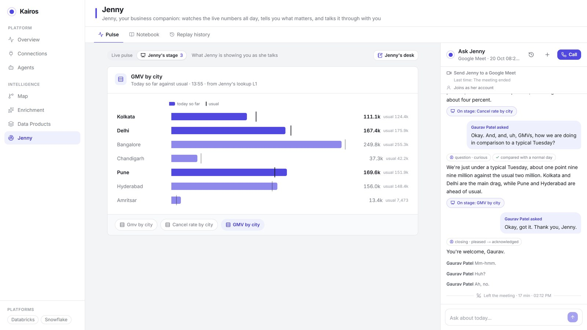
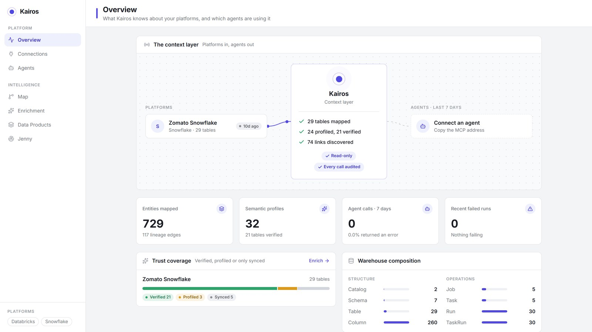
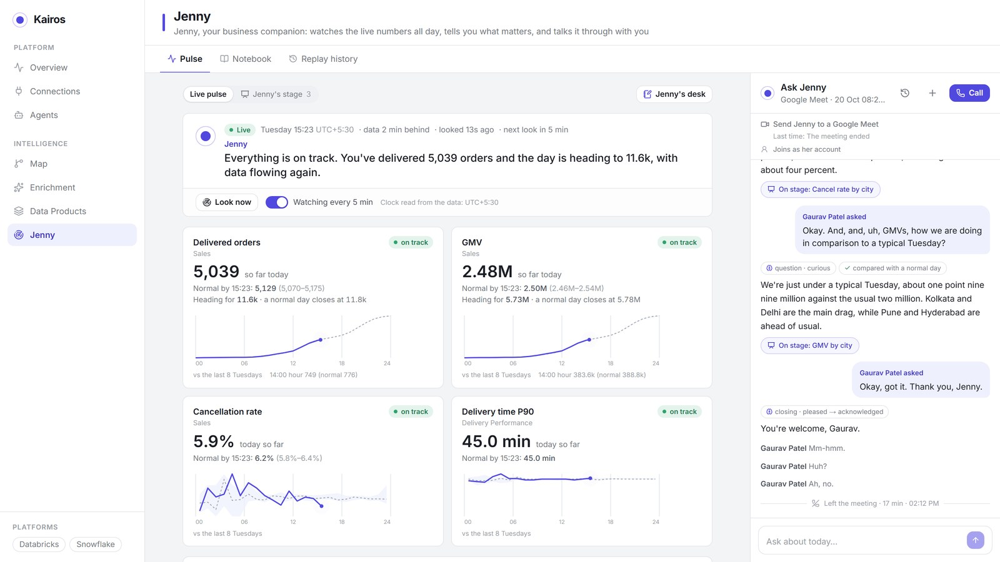
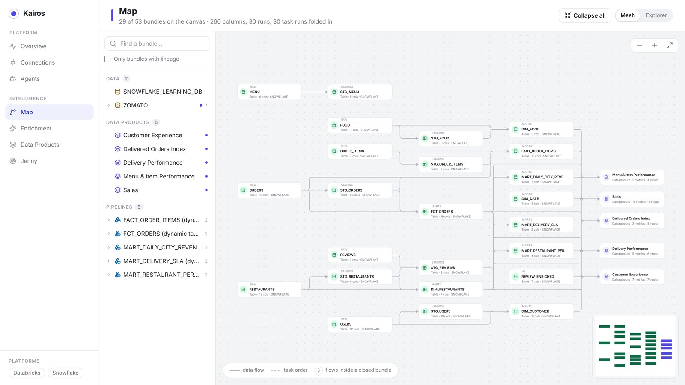
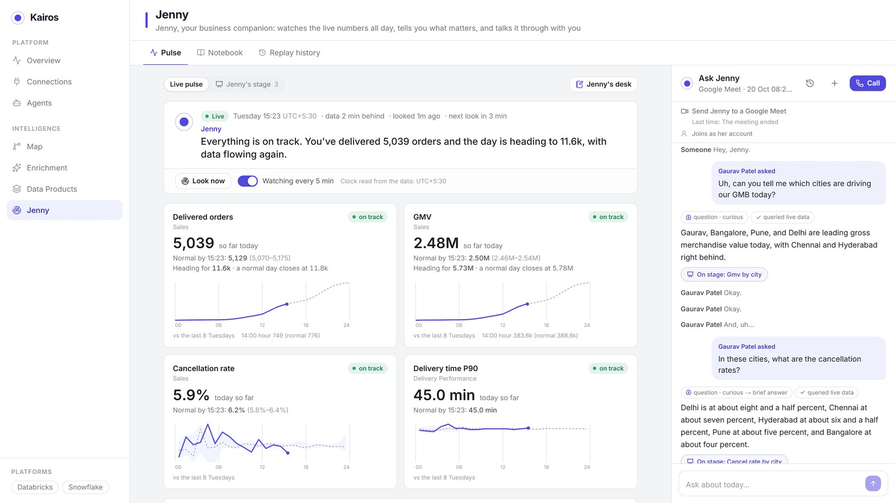
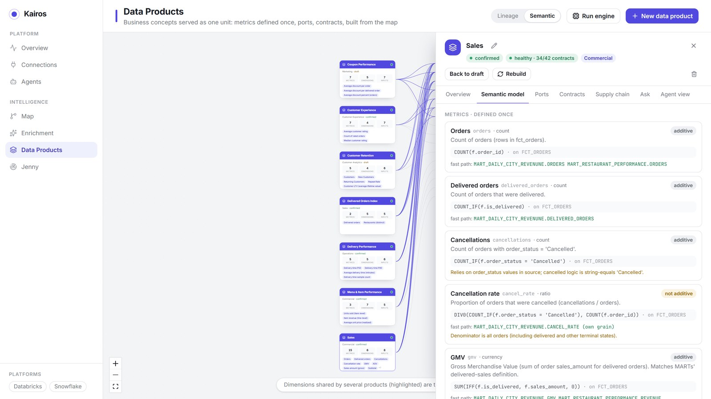
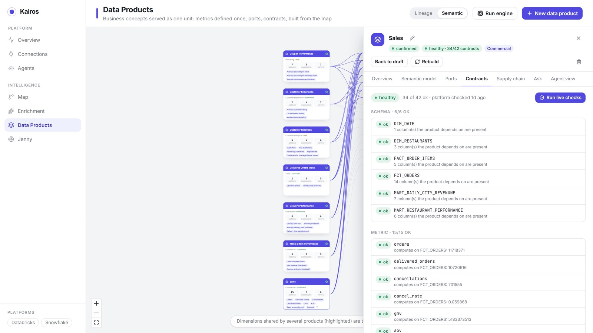
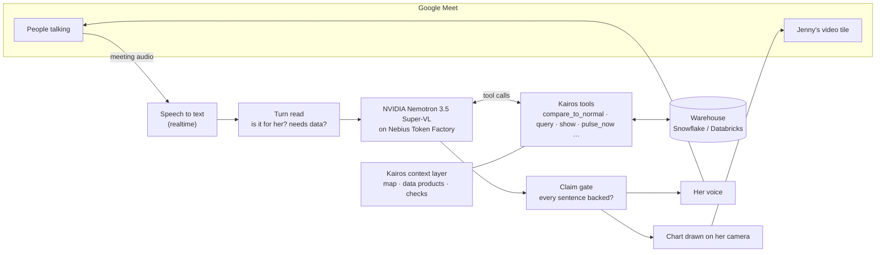

# Kairos + Jenny

**Kairos understands your data. Jenny understands your business.**

Jenny is an AI companion who watches a business's live numbers all day, knows what normal looks like for every hour and
weekday, tells you first when something moves — and joins your Google Meet to answer questions out loud, putting the
chart on her own video tile as she speaks. She runs on **NVIDIA Nemotron, served by Nebius Token Factory**, and she
knows the business through **Kairos**, the context layer between your data and every AI agent.

Built for the **Nebius x NVIDIA Global AI Hackathon** · Track: **Best Apps and Agents**

- 🎬 Demo video (under 3 minutes): https://youtu.be/gE65uxomFlo
- 📄 Devpost: [_submission link_](https://devpost.com/software/kairos-awqno4)



---

## Contents

1. [What it does](#what-it-does)
2. [How we use NVIDIA Nemotron on Nebius Token Factory](#how-we-use-nvidia-nemotron-on-nebius-token-factory)
3. [Architecture](#architecture)
4. [Run it](#run-it)
5. [Configuration](#configuration)
6. [Repository layout](#repository-layout)
7. [What we built during the hackathon](#what-we-built-during-the-hackathon)
8. [Feedback on Token Factory and Nemotron](#feedback-on-token-factory-and-nemotron)

---

## What it does

**Kairos** connects to a warehouse (Snowflake or Databricks) and builds the context an AI agent needs to answer
correctly instead of guessing:

- **Maps** every table, pipeline and column, with lineage, automatically.
- **Turns them into data products** the business understands — Sales, Delivery Performance, Customer Retention — each
  metric defined once, with its SQL.
- **Checks every number with code**: provenance, trust, freshness, lifecycle and attestation (a mart total that
  doesn't reconcile with its base computation is caught before anyone sees it).
- Serves all of it to agents over **MCP** and a REST context API.

**Jenny** is the companion built on Kairos:

- **Live pulse** — she reads the business's vitals every few minutes against the same hour on the last eight
  same-weekdays, and says what matters in one line.
- **Her desk** — things you've asked her to watch ("tell me if cancellations go above seven percent").
- **Chat and calls** — ask in text or by voice; she looks it up and answers in plain numbers.
- **In your meeting** — she joins a Google Meet as a participant, hears the room, answers whoever asked, and draws the
  chart on her camera tile as she talks. Every sentence she says is checked against what her lookups returned first.

| Kairos | Jenny |
|---|---|
|  |  |
|  |  |
|  |  |

The demo runs on a food-delivery dataset in Snowflake (orders, restaurants, menus, users): 29 tables mapped, 7 data
products.

---

## How we use NVIDIA Nemotron on Nebius Token Factory

### Which model does what

| Role | Model (Token Factory id) | Setting | Why |
|---|---|---|---|
| **Jenny** — every spoken and typed turn: plans the lookups, calls Kairos's tools, writes what she says | `nvidia/Nemotron-3.5-Super-VL` | `COMPANION_LLM=nebius:nvidia/Nemotron-3.5-Super-VL` | The only Nemotron in our tests that kept every number tied to what its lookup covered ("I don't have Pizza Hut orders in Mumbai today" instead of quoting the city total), with short, speakable answers |
| **Kairos's reasoning** — enrichment, data products, root-cause analysis, evals | `nvidia/Nemotron-3.5-Super-VL` | `LLM_PROVIDER=nebius`, `NEBIUS_MODEL` | With thinking on, the only one that planned every lookup a profiling question needed in one turn |
| **Fast model** (available to Jenny with `COMPANION_LLM=nebius`) | `nvidia/Nemotron-3_5-Lightning` | `NEBIUS_FAST_MODEL` | Fastest first token; good for simple turns |

### What Nemotron does in one of Jenny's turns

1. The question arrives (typed, a call, or speech-to-text from the meeting).
2. **Nemotron reads it with her tools** — 12 Kairos tools such as `compare_to_normal`, `query` (a data product),
   `show` (put a chart on her stage), `pulse_now` — and plans the lookups. Thinking is switched off for spoken turns
   (`chat_template_kwargs: {enable_thinking: false}`) so the first token comes in about a second.
3. Kairos runs the lookups against the warehouse; each result says exactly what it **covers** (its filters), so a city
   total is never passed off as one restaurant's.
4. **Nemotron writes the answer**, streamed sentence by sentence into her voice; a claim gate checks each sentence
   against the lookups before it's spoken; the chart lands on her tile as she names it.

### Benchmarks on Token Factory

A real streamed tool turn on each Nemotron available to our key, thinking off — run it yourself with
`python -m kairos_kb.llm.nebius_check`:

| Model | First token | Called the tool? |
|---|---|---|
| Nemotron 3.5 Lightning | ~1.0 s | yes |
| **Nemotron 3.5 Super-VL** | **1.1 s** | **yes** |
| Nemotron 3 Ultra 550B | 1.3 s | yes |
| Nemotron 3 Super 120B | — | no (asked for clarification) |
| Nemotron 3 Nano 30B | ~40 s | yes |

End to end in a live voice turn on Super-VL (one to four lookups against Snowflake, then the spoken answer): 4.7–10 s,
during which she has already acknowledged you ("mm-hm, one sec").

### Making open-model tool calling reliable in a live voice loop

Running a voice agent on open models surfaced problems a hosted model had hidden. All fixes are in
[`kairos_kb/companion/chat.py`](kairos_kb/companion/chat.py) and covered by tests in
[`tests/unit/test_nebius_provider.py`](tests/unit/test_nebius_provider.py):

- **Tool calls written as text.** Nemotron sometimes writes `<tool_call><function=…>` (or JSON) as plain text instead of
  a structured call. The stream filter (`ThinkFilter`) keeps those blocks — and any `<think>` reasoning — out of her
  voice, and `text_tool_calls()` turns them into real calls.
- **Silence on the last step.** After her lookup budget, a model shown its own tool calls kept writing one more —
  even with no tools offered — and the answer came out empty. Nemotron's final step now gets no tools, and its lookups
  as plain notes after the question (`_flat()`), with a last retry under minimal instructions.
- **Loosely written arguments.** `"[cancel_rate]"`, `{dimension: city, op: =, value: Delhi}`, `'"gmv desc"'` are repaired
  before the lookup runs (`fix_lists()`), so a retry isn't wasted.
- **Numbers about the wrong thing.** Every query result carries a `covers` line (`covers()`), and Jenny's spoken rules
  for Nemotron are restated last in her instructions (`NEMOTRON_VOICE`), where it follows them best.
- **Structured output** for Kairos's own reasoning goes through function calling (`kairos_kb/llm/provider.py`).

### Where Token Factory accelerated the work

- **OpenAI-compatible API.** Nemotron dropped into the existing client code — streaming, tool calling, LangChain — as a
  base URL and a key; the Nebius path is a few dozen lines in [`kairos_kb/llm/provider.py`](kairos_kb/llm/provider.py).
- **Every Nemotron behind one key.** We benchmarked five models on the real tool loop in an afternoon and switched
  Jenny's model with one setting — no GPUs to provision, no serving stack to run.
- **Fast first tokens** (about a second) made a voice agent on an open model practical in a live meeting.

No other Nebius services are used yet (Serverless Endpoints and Jobs would suit Kairos's background enrichment runs).

---

## Architecture



- **Backend:** Python 3.11, FastAPI, SQLAlchemy (async), PostgreSQL with pgvector, Alembic, Docker Compose.
- **Frontend:** Next.js and React.
- **Jenny's body in a meeting** ([`meet/`](meet/)): a Playwright-driven Chromium that joins as her own Google account;
  her microphone, camera and ears are replaced in the page.
- **Voice:** ElevenLabs when a key is set; [Kokoro-82M](https://github.com/remsky/Kokoro-FastAPI) (open source, CPU) as
  the default and the fallback.
- **Embeddings** stay on `text-embedding-3-large` (Azure OpenAI or OpenAI) so stored vectors remain valid; without a
  key, search falls back to keyword and name matching.

---

## Run it

**You need:** Docker Desktop, Node.js 20+, and a [Nebius Token Factory](https://tokenfactory.nebius.com) API key.
Optional: an ElevenLabs key (Jenny's voice and meeting hearing), a TypeSafe key (her fast turn reads), Azure OpenAI or
OpenAI (embeddings), a Snowflake or Databricks account (your own data).

```bash
git clone <this repo> kairos && cd kairos
cp .env.example .env
#   set NEBIUS_API_KEY (and any optional keys) in .env — LLM_PROVIDER=nebius and Jenny on Super-VL are the defaults

docker compose up -d --build        # Postgres, the API (:8888), Kokoro voice (:8880), Jenny's Meet body (:7070)

cd frontend && npm install && npm run dev     # the app on http://localhost:3000
```

On Windows, `run.bat` does both steps.

**Check Nemotron before anything else** — lists the NVIDIA models on your key and runs a tool turn on each:

```bash
docker compose exec api python -m kairos_kb.llm.nebius_check
```

**Then, in the app:**

1. **Connections** — add your Snowflake or Databricks warehouse (credentials in `.env`, see below). Kairos syncs it and
   builds the **Map**.
2. **Enrichment** and **Data Products** — profile and verify the tables, and build data products (Nemotron does the
   reasoning; checks run against the warehouse).
3. **Jenny** — her live pulse starts on its own. Ask her something in the chat, or press **Call**.
4. **Send Jenny to a Google Meet** — the first time, sign her into her own Google account through the screen that opens
   (served from the Meet container at `localhost:6080`, reachable only from your machine). Then paste a Meet link; admit
   her when she knocks, and say "Hey Jenny".

**Tests:**

```bash
docker compose exec api python -m pytest tests/unit      # backend (671 tests)
cd frontend && npm test                                   # frontend
cd meet && node --test test/cues.test.js                  # the Meet body
```

The API is not hot-reloaded (long enrichment runs live in-process): after a code change run
`docker compose restart api`; after changing `.env` run `docker compose up -d api`.

---

## Configuration

Everything is set in `.env` (see [`.env.example`](.env.example)). The settings that matter for this build:

| Setting | Default | What it does |
|---|---|---|
| `NEBIUS_API_KEY` | — | Your Token Factory key |
| `NEBIUS_BASE_URL` | `https://api.tokenfactory.nebius.com/v1/` | Token Factory's OpenAI-compatible endpoint |
| `LLM_PROVIDER` | `nebius` | Kairos's reasoning: `nebius`, `azure` or `openai` — one setting moves all of it |
| `NEBIUS_MODEL` | `nvidia/Nemotron-3.5-Super-VL` | Kairos's model on Nebius |
| `NEBIUS_FAST_MODEL` | `nvidia/Nemotron-3_5-Lightning` | The fast model (`COMPANION_LLM=nebius`) |
| `COMPANION_LLM` | `nebius:nvidia/Nemotron-3.5-Super-VL` | Jenny's model: `nebius:<id>`, `nebius`, a Gemini id, or `azure` |
| `EMBEDDING_PROVIDER` | (follows `LLM_PROVIDER`; on Nebius stays Azure/OpenAI) | Where embeddings come from |
| `ELEVENLABS_API_KEY` | — | Jenny's voice, and hearing a meeting through realtime speech to text |
| `JENNY_MEET_HEARING` | `audio` with an ElevenLabs key | `audio` (speech to text) or `captions` (Meet's own captions) |
| `TYPESAFE_API_KEY` | — | Jev, the fast read of each turn (is it for her, does it need data) |
| `SNOWFLAKE_*` / `DATABRICKS_*` | — | Warehouse credentials |
| `JENNY_WEB_SEARCH` | off | Web search (Tavily) for outside context — off by design: next to a spike in the numbers, a headline invites a cause the data can't back |

Nothing was removed to add Nebius: Azure OpenAI, OpenAI and Gemini remain one setting away.

---

## Repository layout

```
kairos_kb/              the backend (FastAPI)
  llm/provider.py         one place every model call comes from: azure | openai | nebius
  llm/nebius_check.py     the Nemotron check and benchmark
  companion/              Jenny: her turns (chat.py), brain, pulse, desk, claim gate, voice
  meetings/               Jenny in a meeting: hearing, speech to text, turn-taking
  context/ products/      Kairos: the map, data products, checks, embeddings
  connectors/ warehouse/  Snowflake and Databricks
  mcp_server/             Kairos for any agent, over MCP
frontend/               the app (Next.js)
meet/                   Jenny's body in Google Meet (Playwright + Chromium)
tests/unit/             backend tests
video/                  the demo film (Remotion), built from the real UI
docs/screens/           screenshots
```

---

## What we built during the hackathon

Kairos and the first version of Jenny existed before the submission period. During it we:

- **Added NVIDIA Nemotron on Nebius Token Factory** as an env-based provider for Kairos and for Jenny
  (`kairos_kb/llm/provider.py`, `companion/chat.py`), with structured output through function calling and embeddings
  kept on their existing model.
- **Wrote the Nemotron check and benchmark** (`kairos_kb/llm/nebius_check.py`) and chose models from its results.
- **Made Nemotron's tool calling reliable in a live voice loop** — hidden reasoning and text-form calls, the final-answer
  step, argument repair, scope on every lookup, spoken rules restated for Nemotron.
- **Moved meeting hearing** from Meet's captions to realtime speech to text (words ready about 0.7 s after you stop,
  from 1.2–2.2 s), added natural listener sounds ("mm-hm", "one sec"), and fixed how she tells she's being addressed.
- **Fixed her camera for wide Meet tiles**, which had cropped chart titles and axes.
- **Recorded the demo with Jenny on Nemotron 3.5 Super-VL.**

---

## Feedback on Token Factory and Nemotron

- **Tool calls as text.** Lightning sometimes emits `<tool_call><function=…><parameter=…>` as content rather than a
  structured `tool_calls` delta. Server-side parsing of that format into `tool_calls` would save every app the same
  workaround.
- **Final answers after a long tool history.** Shown its own earlier tool calls, Lightning tended to continue the
  pattern instead of answering — with `tool_choice: none`, and even with no tools in the request. Super-VL didn't, in
  our tests.
- **Super-VL was the standout** for an agent: fast first token with thinking off, reliable tool calls, and it keeps a
  number tied to what was measured. The model list endpoint made comparing all five quick.
- **`chat_template_kwargs.enable_thinking`** worked exactly as needed for latency-sensitive turns; documenting it next to
  each model on Token Factory would help.

---

## License

Copyright 2026 Gaurav Patel. Licensed under the [Apache License, Version 2.0](LICENSE).
